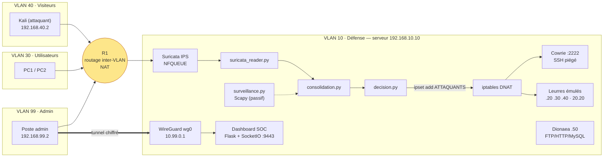

# Détection et leurrage de scans réseau par honeypots adaptatifs

> Système de défense réseau multicouche qui **détecte** les reconnaissances (Suricata en IPS),
> **décide** (modules Python), **redirige** l'attaquant de façon transparente (iptables + ipset)
> vers des **leurres** (Cowrie, Dionaea, services émulés), et **documente** tout dans un
> tableau de bord SOC temps réel, administrable à distance par **VPN WireGuard**.

Travaux de recherche en sécurité réseau (déception active et détection d'intrusion), menés en Licence d'Administration des Réseaux Informatiques (ENEAM, Université d'Abomey-Calavi) à partir d'un besoin réel observé en stage. Le laboratoire d'origine (GNS3 + VirtualBox) est ici **entièrement conteneurisé et reproductible** : une commande suffit pour le relancer, avec les mêmes versions et les mêmes configurations, et rejouer les expériences.

📄 **Rapport de recherche complet (PDF, 14 p.)** : [`docs/rapport-recherche.pdf`](docs/rapport-recherche.pdf)


---

## Démarrage rapide

Prérequis : Linux, Docker ≥ 24 avec Docker Compose v2, ~3 Go d'espace disque.

```bash
git clone <url-du-depot> && cd honeypot-defense-lab
make up        # construit et démarre les 10 conteneurs
make demo      # rejoue les expériences de bout en bout (≈ 1 min)
make password  # identifiants du tableau de bord -> http://localhost:9443

# Protocole expérimental pas à pas (scan, hydra, honeypots, rapport) :
#   voir docs/EXPERIENCES.md
```

Résultat attendu de `make demo` :

```
== 1. Reconnaissance : nmap -sS depuis la Kali (192.168.40.2, VLAN 40) ==
  [OK] Suricata : 157 nouvelles alertes de scan (paquets bloqués en ligne)
== 2. Redirection dynamique (decision.py -> ipset) ==
  [OK] 192.168.40.2 inscrit dans l'ipset ATTAQUANTS : son trafic part vers les leurres
== 3. Session SSH piégée (Cowrie) ==
  kali$ srv-prod-01
  [OK] l'attaquant croit être sur srv-prod-01 : c'est Cowrie
== 4. Capture d'une charge malveillante (Dionaea, FTP 192.168.10.50) ==
  [OK] fichier capturé — SHA-256 : ad40ccbf…
== 5. Administration à distance par VPN WireGuard (10.99.0.1) ==
  [OK] SSH via le tunnel : vrai serveur (server), pas le leurre
== 6. Exemption du VLAN 99 et isolement du tableau de bord ==
  [OK] l'attaquant ne peut pas joindre le tableau de bord
== Bilan : 9 réussis, 0 échoués ==
```

## Architecture



| VLAN | Rôle | Réseau | Hôtes |
|---|---|---|---|
| 10 | Système de défense | 192.168.10.0/24 | serveur `.10`, leurres `.20` `.30` `.40`, Dionaea `.50` |
| 20 | Serveurs applicatifs | 192.168.20.0/24 | leurre `192.168.20.20` (routé via le serveur pour passer par l'IPS) |
| 30 | Utilisateurs | 192.168.30.0/24 | PC1 `.2`, PC2 `.3` |
| 40 | Visiteurs | 192.168.40.0/24 | Kali attaquant `.2` |
| 99 | Administration | 192.168.99.0/24 | poste admin `.2` — **jamais redirigé** |

### Chaîne de traitement d'un paquet hostile

1. Le paquet de l'attaquant traverse R1 et arrive sur le serveur de défense.
2. iptables le place dans la file **NFQUEUE 0** ; **Suricata** l'inspecte en ligne avec 7 règles maison (SYN, NULL, XMAS, FIN, scan massif, UDP ; ping sweep désactivé après calibrage) et le **bloque** (`drop`).
3. `suricata_reader.py` suit `eve.json` en temps réel (50 ms) et transmet l'alerte par **socket UNIX** à `consolidation.py`, qui arbitre entre Suricata (décisif) et Scapy (informatif).
4. `decision.py` inscrit l'adresse dans l'**ipset ATTAQUANTS** (expiration 1 h) : les règles DNAT existantes s'appliquent instantanément, sans ajout de règle par attaquant.
5. Les connexions suivantes de l'attaquant aboutissent sur **Cowrie** (SSH sur tous les ports TCP) ou sur les leurres ; chaque commande, session et fichier est consigné.
6. Le **VLAN 99** et le **tunnel WireGuard** sont exemptés par des règles `RETURN` en tête de `PREROUTING`.

## Composants

| Module | Rôle | Technologie | Dossier |
|---|---|---|---|
| 1. Surveillance passive | journalise les scans observés, sans décider | Python, Scapy | [`defense/modules/surveillance.py`](defense/modules/surveillance.py) |
| 2. Détection active | inspection et blocage en ligne | Suricata 7.0.3 (NFQUEUE) | [`defense/suricata/`](defense/suricata/) |
| 3. Redirection dynamique | décision + ipset + DNAT | Python, iptables, ipset | [`defense/modules/`](defense/modules/), [`setup_iptables.sh`](defense/scripts/setup_iptables.sh) |
| 4. Leurres réseau | bannières réalistes (Apache, Postfix, SMB/RDP, Nginx) | Python (profils inspirés de Honeyd), farpd | [`honeyd_services.py`](defense/modules/honeyd_services.py) |
| 5. Honeypot SSH | shell émulé, sessions rejouables | Cowrie 3.0.3 | [`cowrie/`](cowrie/) |
| 6. Capture de malwares | services vulnérables, empreinte SHA-256 | Dionaea 0.11 | [`dionaea/`](dionaea/) |
| 7. Tableau de bord SOC | 6 vues temps réel, rapport forensique PDF | Flask, SocketIO, Chart.js, fpdf2 | [`dashboard/`](dashboard/) |
| 8. Administration à distance | tunnel hôte-à-hôte cloisonné | WireGuard | [`vpn_admin.sh`](defense/scripts/vpn_admin.sh) |

## Résultats expérimentaux (laboratoire GNS3 d'origine)

Séance d'évaluation de 40 minutes, 4 439 règles chargées :

- **6 402 paquets bloqués sur 6 412 inspectés (99,84 %)** ; les 10 restants étaient du trafic d'administration légitime ;
- inscription de l'attaquant dans l'ipset **en moins d'une seconde** ;
- **7 sessions SSH piégées** dans Cowrie, dont une authentifiée ;
- **416 connexions** captées par Dionaea et un fichier malveillant identifié par SHA-256 ;
- redémarrage complet sans intervention : les 8 services et les attaquants piégés sont restaurés.

## Utilisation

```bash
make kali       # shell sur l'attaquant : nmap, ssh, lftp, curl…
make admin      # shell sur le poste admin (VPN actif) : ssh 10.99.0.1
make logs       # journaux du serveur de défense en direct
make down       # arrêt (données conservées) — make clean pour tout effacer
```

Exemples depuis `make kali` :

```bash
nmap -sS 192.168.10.10            # déclenche la détection
nmap -sV -p 22,80,443 192.168.10.20  # un « serveur web » qui n'existe pas
ssh root@192.168.10.10            # mot de passe : root -> Cowrie
lftp -u root,root 192.168.10.50   # FTP de Dionaea
```

## Du laboratoire GNS3 aux conteneurs

| Laboratoire d'origine | Version conteneurisée |
|---|---|
| Routeur Cisco c7200 (IOS 15.2) | `r1` : routeur Linux, mêmes passerelles `.1`, NAT, redirection udp/51820 |
| Commutateur NM-16ESW, 5 VLANs | 5 réseaux Docker macvlan isolés |
| VM Ubuntu Server 24.04 (8 unités systemd) | `defense` + `cowrie` + `dionaea` + `dashboard`, partageant la même pile réseau |
| VM Kali Linux | `attacker` (Kali rolling, outils des essais) |
| VM Administrateur | `admin` (client WireGuard) |
| VPCS PC1 / PC2 | `pc1`, `pc2` |

Le code et les configurations sont ceux de la VM, extraits de son disque. Les seules adaptations (nom d'interface, absence de systemd, clés générées au démarrage) sont détaillées dans [`docs/NOTES.md`](docs/NOTES.md). Les configurations Cisco et le projet GNS3 d'origine sont dans [`docs/gns3-original/`](docs/gns3-original/) ; les images IOS, propriétaires, ne sont pas fournies.

## Sécurité

- Aucun secret dans le dépôt : clés WireGuard et SSH, ainsi que le mot de passe du tableau de bord, sont **générés localement** au premier démarrage (volume `lab-secrets`).
- Le lab est conçu pour un usage **isolé et pédagogique**. Les honeypots ne doivent pas être exposés à Internet sans une analyse de risque : l'isolation par conteneur n'est pas absolue.

## Limites connues

- Détection par **signatures et seuils fixes** : un balayage très lent (un paquet toutes les 10 minutes) passe sous les seuils.
- Validation en laboratoire, avec un seul attaquant et des outils courants.
- Les leurres trompent un `nmap` ordinaire, mais un adversaire attentif peut repérer des incohérences de bannières ou de temps de réponse.

## Pistes d'évolution

- Détection comportementale (apprentissage automatique léger sur `eve.json`) pour les scans lents.
- Envoi des événements vers un SIEM (Wazuh, Elastic).
- Leurres à fidélité adaptative : basculer un attaquant vers un leurre plus riche quand il s'engage.

## Auteur

Tiburce Fatchehoun (2026) — Licence en Administration des Réseaux Informatiques, ENEAM, Université d'Abomey-Calavi.
